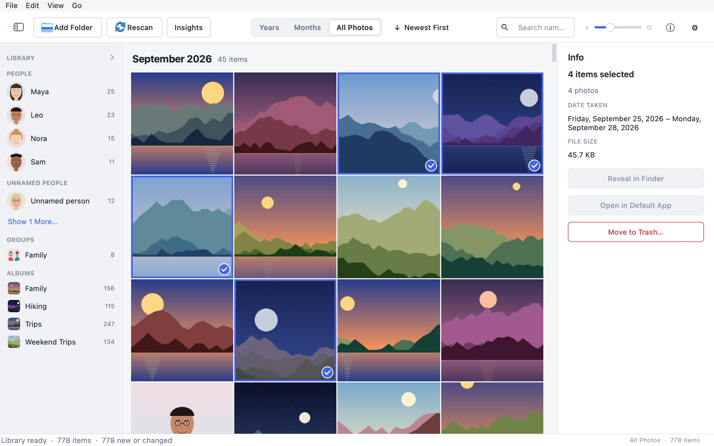
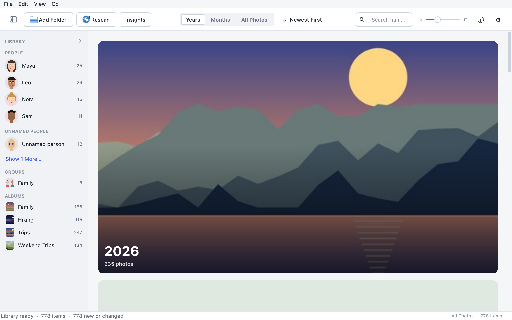
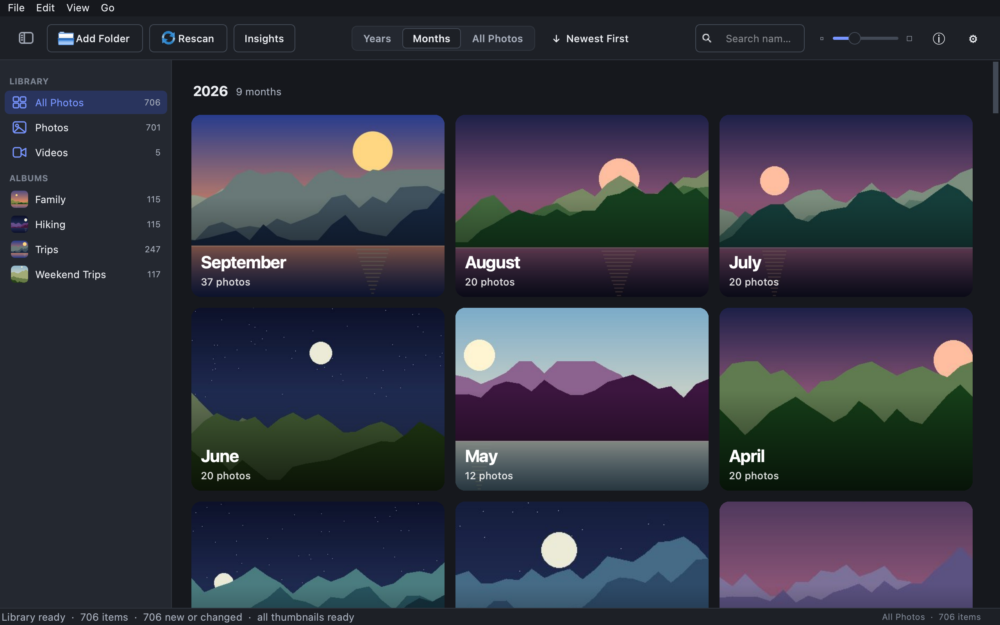
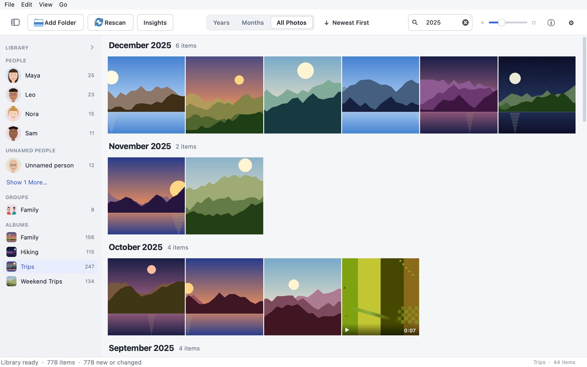
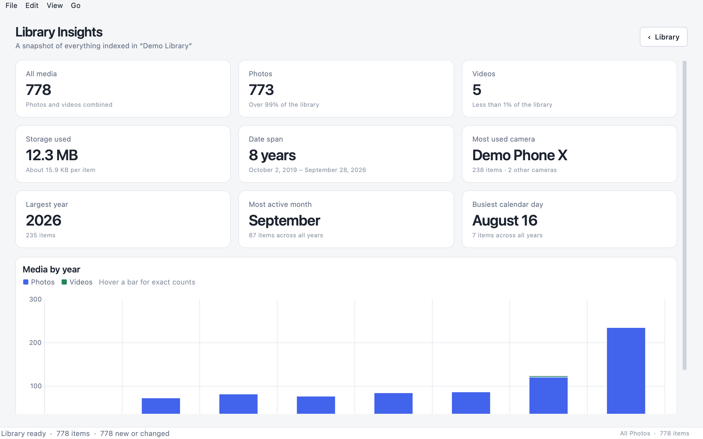
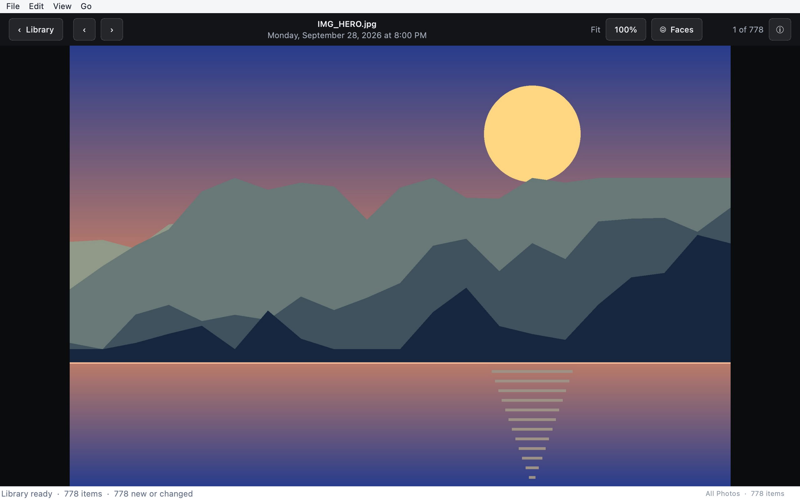

# Photo Library

A fast, private desktop library for the photos and videos in your folders, built with
PySide6. Pick one or more folders and browse everything in them newest first, grouped by month, in
the style of Apple Photos. Indexing, thumbnails and playback all happen on your
computer. Nothing is uploaded.

The look and the media core (capture-date detection, HEIC support, thumbnail cache,
incremental indexer) come from the On This Day app.

## Features

- **Library folders** chosen once and remembered. It's indexed in the background with a
  progress bar. Every launch, and **Rescan**, picks up added, changed and deleted files. When
  nothing changed this is a quick check (under a second for about 36,000 files): only new or
  edited files are read. After an update that reads files in a new way (say, better video
  dates), every file is read once more on the next launch. Quitting part-way loses nothing;
  the next launch carries on.
- **Capture dates** come from the photo's own EXIF date, a video's camera date (in the
  camera's local time, as for photos), or Spotlight. For files with none of those, the earlier
  of the file's creation and modification time is used, never the time it was copied.
- **Several folders in one library:** **Add Folder** (⌘O) adds another folder, for
  example `~/Pictures` plus a backup drive. Their photos merge into one timeline, and the
  sidebar's **Folders** section shows each folder on its own. Remove a folder from File ▸
  Remove Folder from Library or by right-clicking it in the sidebar. Its files stay on disk;
  only the app's index of it is dropped. Folders can't overlap (one inside another). If a
  folder is missing, for example an unplugged drive, its photos stay in the library and the
  other folders keep updating.
- **Updates by itself:** the folder is watched (FSEvents on macOS, ReadDirectoryChangesW on
  Windows), so photos you add, move between folders or delete show up a few seconds later,
  with no ⌘R needed. Every library folder is watched. A big copy is handled as one update once it finishes. Just viewing or
  playing a file never counts as a change. You can turn this off in Settings.
- **Virtualized grid** that stays smooth with 50,000+ items. It has month section
  headers with a sticky header at the top, and a thumbnail size slider.
- **Years / Months / All Photos** views. Click a year to see its months, and a month to
  jump to it in All Photos. Year and month tiles use larger, sharp cover images.
- **Live Photos:** an iPhone Live Photo (for example `IMG_4330.HEIC` plus `IMG_4330.MOV`)
  shows once, as a photo with a LIVE badge, not as a photo plus a separate 1–3 second video.
  In the viewer, **◉ LIVE** (or L) plays the motion. Moving one to the Trash takes both files.
- **Sidebar**: All Photos, Photos and Videos with counts, the library folders (when there
  is more than one), plus each top-level subfolder as an **album** with its newest photo as
  a thumbnail. An album includes everything in its nested folders. When two folders have an
  album with the same name, each is labelled with its folder, as in "Trips — Backup Drive".
  Click a section heading (Library, Folders, People, Unnamed People, Groups, Albums and the hidden lists) to fold it away or open it
  again; the app remembers which are folded. Hide the whole sidebar with the sidebar button at
  the left of the toolbar, or ⌥⌘S.
- **People** (optional, off until you turn it on in Settings): the app finds the faces in
  your photos, groups the same person together and lists everyone in a **People** section of
  the sidebar, with a round face picture and a photo count. Named people are listed under
  **People** and everyone else under **Unnamed People**, which you can fold away. Click a person to see their photos
  in the normal grid (Years, Months, search and the viewer all work there). Right-click a
  person to **Name…** them, **Merge Into** another person, or **Hide Person**. To take wrongly
  matched photos out of a person, select them and right-click ▸ **Not Ana – Remove from Ana**
  (or press ⌥⌫, which also works on the photo open in the viewer).
  - **Review Suggestions** (top of the People section, or ⇧⌘P) asks about faces that look like
    someone you have named but weren't grouped with them: "Is this Ana?" Answer with Y, N, or →
    to skip. Your answers are kept, even when people are regrouped. Only named people are
    suggested, so name someone to get suggestions for them; the many unnamed groups (mostly
    passers-by) never produce questions.
  - **Groups:** right-click a person ▸ **Add to Group** ▸ **New Group…** (or View ▸ New
    Group…), name it and tick its people. The group, under **Groups** in the sidebar, shows the
    photos in which everyone in it appears together. Right-click a group to rename it, edit its
    members or delete it; deleting a group never touches its people or photos. A member stays in
    the group even while none of their photos are shown (for example, only in a hidden album).
  - **Check Faces:** right-click a person ▸ **Check Faces (Least Typical First)** (or View ▸
    Least Typical Faces First) to list their photos with the least typical face first. Wrong
    matches gather at the top, so a quick look there is enough to check a person.
  - **Faces in the viewer:** press F (or the Faces button) to outline every face with its
    name. Click a face to confirm it, say it isn't that person, choose who it is, or start a
    new person, which fixes one face in a group photo without touching the others.
  - **Private:** faces are found and grouped on your computer. No photo or face leaves it.
  - **Names are kept:** they survive moving or renaming photos and folders, re-analysis, and even
    a lost database: names, hidden people, groups (unnamed members included) and each person's
    reference face are also backed up to `~/.photo_library/people.json` (private: it holds face
    fingerprints, not photos).
  - **How:** two open models from the [OpenCV model zoo](https://github.com/opencv/opencv_zoo),
    YuNet (finds faces, MIT licence) and SFace (face fingerprints, Apache 2.0), downloaded
    once (about 38 MB) and checked against fixed checksums. Fingerprints are grouped with
    DBSCAN. Names, merges and removals are kept when new photos are added.
  - **Cost:** the first pass reads every photo once in the background, after thumbnails are
    ready, and pauses while a video plays or a scan runs. Later passes look only at new or
    edited photos. Videos aren't analysed.
- **Hide an album:** right-click it in the sidebar and choose **Hide Album**. Its photos
  disappear from All Photos, Photos, Videos, Years, Months, search, the counts and Insights,
  and it moves to a **Hidden Albums** section. You can still open it from there. Right-click ▸
  **Show Album in All Photos** brings it back. Nothing on disk changes.
- **Search** (⌘F) by filename words and by date: `2023`, `May`, `May 2023`, `2023-05`,
  `2023-05-14` or `14 May 2023`. Words and dates combine (`beach 2023`). Search applies
  to the current sidebar selection. Esc clears it, and Return jumps to the results.
- **Info panel** (⌘I or the ⓘ button) shows the filename, date taken, dimensions, file
  size, camera, duration for videos, album and path. It has **Reveal in Finder** and
  **Open in Default App** buttons. With several items selected it shows the count, the
  date range and the total size. It works in the viewer too.
- **Selection** works like Photos: click, ⌘-click to add, ⇧-click for a range, ⌘A, and Esc
  to deselect. Right-click for Open, Get Info, Reveal, Open in Default App and Move to Trash.
- **Move to Trash** (⌘⌫) works on the selection, or on the item open in the viewer. It
  always asks first, names what will be moved, and uses the system Trash (`QFile.moveToTrash`),
  so files can be restored. Trashed items leave the grid without a reload, the scroll
  position stays put and the next item is selected. Files that couldn't be moved are listed.
- **Library Insights** (the **Insights** toolbar button or ⌘⇧I) gives a snapshot of the
  whole library:
  - photo, video and total counts, and the storage they use
  - the date span from the oldest to the newest capture
  - the most used camera
  - the largest year, the most active month and the busiest calendar day
  - a photos-and-videos-by-year chart; hover a bar for exact counts

  It reads only the index, so it opens instantly and never rescans. It refreshes after
  each scan. Esc returns to the grid.
- **Empty states** for no folder, an empty library, an empty album, and no search results.
- **Sort order:** the toolbar button (or View → Newest First / Oldest First) switches between
  newest first and oldest first, so each month starts at its 1st. It applies everywhere:
  albums, Photos/Videos, search, Years/Months and the viewer's ← / →. It's remembered
  between launches. If you're at the top when you switch, you stay at the top; further
  down, the photo you were looking at stays in view.
- **Viewer**: double-click, Return or ⌘↓ opens an item full-window. ← and → step through
  the library. Esc (or ⌘↑) returns to the grid exactly where you left it.
  - **Photos** are shown with their EXIF rotation applied. Zoom with ⌘-scroll, pinch,
    ⌘= / ⌘−, or a double-click (Fit ↔ 100%), and drag to pan. The grid thumbnail
    appears at once, then a screen-sized decode replaces it; zooming in past that loads
    the full-resolution image. The next and previous photos are decoded in advance.
  - **Videos** play in the app (QtMultimedia) with play/pause, a scrubber, time, volume
    and mute.

## Screenshots

These screenshots come from a synthetic demo library of computer-drawn landscapes with
made-up dates. They contain no personal photos, file paths or metadata. To regenerate
them, run `python tools/make_screenshots.py`.

### Library with the info panel

All Photos grouped by month, with albums in the sidebar and a multi-item selection
summarised in the info panel.



### Years

One tile per year. Click a year to see its months.



### Months, in dark mode

Month tiles grouped by year, shown with the dark theme.



### Search within an album

Searching "2025" inside the Trips album.



### Library Insights

Totals, storage, date span, the most used camera, the busiest times, and media by year.



### Viewer

Full-window photo viewer with previous and next, zoom and the info toggle.



## Settings

Open **Settings** with ⌘, or the ⚙ button at the right end of the toolbar (also in the app menu on macOS, or File on other systems) to choose:

- **Theme**: follow the system appearance, or always light or dark.
- **Time format**: follow the system clock, a 12-hour clock (1:30 PM) or a 24-hour
  clock (13:30). It applies wherever a capture time is shown, such as the viewer header.
- **Update automatically when files change** (on by default): turn off to rely on
  Rescan (⌘R) instead.
- **Find people in photos** (off by default): turns on People. The first time, the two face
  models (about 38 MB) are downloaded. It needs OpenCV (`opencv-python-headless`).

Qt Multimedia's informational messages (the "Using Qt multimedia with FFmpeg" banner
and FFmpeg's per-file stream details) are hidden. Warnings and errors still appear. To
see everything while debugging, run:

```bash
QT_LOGGING_RULES="qt.multimedia.*=true" python app.py
```

## Requirements

- Python 3.10 or newer (developed on 3.14)
- macOS is the primary target. Windows 11 is tested too, including a Start menu launcher;
  Linux should work
- Dependencies in `requirements.txt`:
  - PySide6
  - Pillow
  - pillow-heif (HEIC/HEIF)
  - imageio-ffmpeg (video dates, thumbnails and metadata)
  - watchdog (folder watching)
  - opencv-python-headless (People: finding and recognising faces; brings numpy)

The app still runs without pillow-heif, imageio-ffmpeg, watchdog or OpenCV; HEIC files, video
previews, automatic updates or People are then limited or unavailable.

## Run it

```bash
python3 -m venv .venv
source .venv/bin/activate
python -m pip install -r requirements.txt
python app.py
```

On Windows (PowerShell):

```bash
py -m venv .venv
.venv\Scripts\Activate.ps1
python -m pip install -r requirements.txt
python app.py
```

### Launch it like an app (macOS)

```bash
python tools/make_launcher.py
```

This builds `dist/Photo Library.app` and installs a copy in `~/Applications`. You can
double-click it, find it with Spotlight, or drag it to the Dock. It's a few KB and contains
no code of its own: it runs this project's `app.py` with the project's `.venv`, so it
always runs your latest code. Notes:

- While the app is running, macOS shows it as **Python** in the Dock and menu bar,
  because Homebrew's Python framework runs apps inside its own `Python.app`.
- Re-run the script if you move the project folder or recreate `.venv`. If the project
  can't be found, the launcher shows an alert.
- Output and errors go to `~/.photo_library/launcher.log`.

### Launch it like an app (Windows)

```bash
.venv\Scripts\python tools\make_launcher.py
```

This creates a **Photo Library** shortcut with its own icon in `dist\` and copies it into
the Start menu and onto the Desktop. Search for it from Start, or right-click it there to
pin it to Start or the taskbar. Like the macOS launcher, it runs this project's `app.py`
with `.venv\Scripts\pythonw.exe`, so there's no console window and it always runs your
latest code. Notes:

- Re-run the script if you move the project folder or recreate `.venv`.
- `--no-install` only builds `dist\Photo Library.lnk`.
- Errors go to `~/.photo_library/photo_library.log`.

To try it without your own photos, generate a synthetic library first:

```bash
python tools/make_demo_library.py ~/Desktop/demo-library --photos 2000 --videos 10
```

## Keyboard shortcuts

On macOS, ⌘ is Command. On Windows and Linux, use Ctrl.

| Action | Shortcut |
| --- | --- |
| **Library** | |
| Add folder to library | ⌘O |
| Rescan library | ⌘R |
| Search by name or date | ⌘F (Esc clears it, Return jumps to the results) |
| Years / Months / All Photos | ⌘1 / ⌘2 / ⌘3 |
| Newest first / oldest first | Sort button in the toolbar, or the View menu |
| Bigger / smaller thumbnails | ⌘= / ⌘− (or ⌘-scroll, or pinch) |
| Show or hide the sidebar | ⌥⌘S |
| Show or hide info | ⌘I |
| Library Insights | ⌘⇧I (Esc returns) |
| Review People | ⌘⇧P, then Y / N / → (Esc returns) |
| **Selecting** | |
| Move between items | Arrow keys, Page Up/Down, Home/End |
| Add to the selection / select a range | ⌘-click / ⇧-click (or ⇧-arrows) |
| Select all / deselect all | ⌘A / ⌘⇧A (Esc also deselects) |
| **Items** | |
| Open in the viewer | Double-click, Return, Space or ⌘↓ |
| Move to Trash (asks first) | ⌘⌫ or Delete |
| Reveal in Finder | ⌘⇧R |
| Open in default app | ⌘⇧O |
| More actions | Right-click an item |
| **Viewer** | |
| Back to the grid | Esc or ⌘↑ (Space also closes a photo) |
| Previous / next item | ← / → (Home / End for first / last) |
| Zoom photo / actual size | ⌘= / ⌘−, ⌘0 (or double-click, pinch, ⌘-scroll) |
| Play / pause, skip 5 s, mute | Space, ⇧← / ⇧→, M |
| Play a Live Photo | L (or the ◉ LIVE button) |
| Show faces and names | F (or the ☺ Faces button) |
| Remove photos from the person shown | ⌥⌫ in the grid or viewer (or right-click ▸ Not …) |
| **App** | |
| Settings (appearance, 12/24-hour time, People) | ⌘, or the ⚙ toolbar button |
| Close window | ⌘W |

## How it stays fast

- **Indexing** (`core/indexer.py`) walks each library folder in turn with `os.scandir`. It reads
  metadata on a thread pool, and every SQLite write happens on the indexer's single
  thread. Unchanged files (same size and modification time) are skipped.
- **The grid** (`ui/grid_view.py`) is a custom `QAbstractItemView`. Its geometry comes
  from `core/grid_layout.py`, which works on month sections, not individual items. Lookups
  are binary searches, so painting and hit-testing only touch the cells on screen.
- **Thumbnails** are created once and cached on disk (512 px, aspect kept). Creating
  one means decoding the original: about 50 ms for a 12 MP JPEG and about 450 ms for a HEIC.
  Reading a cached one takes about 1 ms.
  - **Prepared in advance.** After each scan, `core/thumbnail_warmer.py` creates every
    missing thumbnail in the background, newest first, using half the CPU cores. The
    status bar shows its progress. Once it finishes, scrolling never waits on an original.
    In a test with 150 ms per original, blank cells while scrolling dropped from 78% to 0%.
    It's a one-time cost: rescans only prepare new or changed files. It pauses while a
    video plays and resumes afterwards, so playback stays smooth.
  - **Loaded around you.** `ui/thumbnails.py` decodes cached thumbnails on worker threads
    at about the cell's size and keeps them in an in-memory LRU of about 480 MB. While you
    scroll, visible cells load first and work for cells that scrolled away is dropped. When
    you stop, the next 5 screens and the previous 2 are loaded too.
  - **Why not everything in memory?** Each decoded thumbnail is about 0.5 MB, so a
    50,000-item library would need about 25 GB of RAM. Disk-cached thumbnails plus
    read-ahead give the same smooth scrolling at a fixed memory cost.
  - **Sharp covers.** Years and Months tiles are far bigger than grid cells, so each cover
    also gets a 1,600 px version, about one per month and per year.
  - **Tried again.** A thumbnail that couldn't be made (a drive asleep or unplugged) is tried
    again after 30 seconds; a file that really can't be read is remembered on disk and skipped.
  - **Cleaned up.** Editing, moving or deleting a file leaves its old thumbnail behind. After
    preparation, `core/cache_cleanup.py` deletes thumbnails no indexed file needs, so the
    cache doesn't grow forever.
- **The UI thread never reads files or the database.** Queries, grouping, settings
  writes and thumbnail decoding run in the background (`ui/tasks.py`). Python hands the
  GIL around every 1 ms instead of 5 ms, so that pure-Python background work (scans,
  thumbnail checks) never makes the UI or video playback wait.
- **Freezes are logged.** If the UI thread stops responding for more than 80 ms,
  `ui/freeze_monitor.py` writes what every thread was doing to the log, then how long the
  freeze lasted.
- **Only real changes trigger a rescan.** Windows reports a file as modified when only its
  last-access time changes, which happens the first time it's read (playing a video,
  making a thumbnail). The watcher ignores "modified" files whose contents weren't
  written recently.

## Project structure

```text
app.py                     Entry point
CHANGELOG.md               What changed in each version (VERSION is in core/constants.py)
photolibrary/
├── core/                  No Qt imports; unit-tested
│   ├── constants.py       Paths, supported formats, thumbnail size
│   ├── database.py        SQLite index (WAL) and MediaRepository queries
│   ├── indexer.py         Incremental background indexer (one folder, or all of them in turn)
│   ├── library_roots.py   Library folder rules: no overlaps, matching, sidebar names
│   ├── media.py           Dates, metadata, thumbnails, open/reveal helpers
│   ├── grouping.py        Month sections and Years/Months summaries
│   ├── grid_layout.py     Sectioned grid geometry
│   ├── search.py          Search box parsing (filename and dates)
│   ├── trash.py           Move to Trash plus index and thumbnail cleanup
│   ├── live_photos.py     Pairs Live Photo stills with their motion clips
│   ├── faces.py           People: face models (download and checksum), finding faces in photos
│   ├── people.py          People: grouping face fingerprints (DBSCAN) and keeping names stable
│   ├── watcher.py         Folder watching (watchdog: FSEvents, ReadDirectoryChangesW) with change batching
│   ├── thumbnail_warmer.py Background creation of missing thumbnails and covers
│   ├── cache_cleanup.py   Removes thumbnails no indexed file needs
│   ├── cache.py           Cost-bounded LRU cache
│   ├── workqueue.py       Re-prioritisable background job queue
│   ├── formatting.py      Labels for sizes, durations, dates
│   ├── zoom.py            Viewer zoom and pan arithmetic
│   └── settings.py        Remembered settings (JSON)
└── ui/
    ├── main_window.py     Toolbar, sidebar, search, menus, indexing and query plumbing
    ├── time_format.py     12/24-hour clock preference
    ├── grid_view.py       Virtualized grid view and thumbnail delegate
    ├── grid_model.py      Qt model over a library snapshot
    ├── thumbnails.py      Background thumbnail loader and pixmap cache
    ├── tasks.py           run_async helper for background work
    ├── freeze_monitor.py  Logs what every thread was doing when the UI stalls
    ├── viewer_images.py   Background full-size photo decoding for the viewer
    ├── pages/             Grid page, full-window viewer, Library Insights and Review People
    ├── theme/             Colours, typography, metrics, stylesheet, themed checkboxes
    └── widgets/           Sidebar, info panel, image canvas, video player, face pictures, empty state, search box
tests/                     unittest suite: core modules, plus tests/ui (the real window, headless)
tools/make_demo_library.py Synthetic library generator
tools/make_launcher.py     Builds the macOS launcher app or the Windows shortcut
tools/make_screenshots.py  Regenerates the README screenshots
assets/screenshots/        README screenshots (synthetic demo library)
```

## Development

Run the tests from the project root:

```bash
python -m unittest -v
```

The suite has 252 tests (about a minute and a half). It includes headless UI tests that drive
the real window (grid, selection, viewer, trash, search, sort, albums, Insights, Live Photos,
People, groups and Review, folder watching, theme changes, the freeze monitor and pausing
thumbnail work during playback) on a generated library. People tests use a fake face engine,
so they need no models. To skip the UI tests while iterating (about 25 seconds, mostly the folder-watching tests):

```bash
SKIP_UI_TESTS=1 python -m unittest
```

If the app or video playback pauses, look for "UI thread not responding" in
`~/.photo_library/photo_library.log`: each entry shows what every thread was doing at that
moment.

App data (config, the SQLite index, thumbnails and the log) lives in
`~/.photo_library/`. Set `PHOTO_LIBRARY_HOME` to use a different folder, for example
for a demo library:

```bash
PHOTO_LIBRARY_HOME=/tmp/photo-demo python app.py
```

## Project status

The app is under active development. Use a backed-up media library, review detected
capture dates, and keep the local app-data directory out of source control.

## Development approach

Developed with AI-assisted tools under human direction, review, testing, and refinement.

## License

This project is available under the [MIT License](LICENSE).
