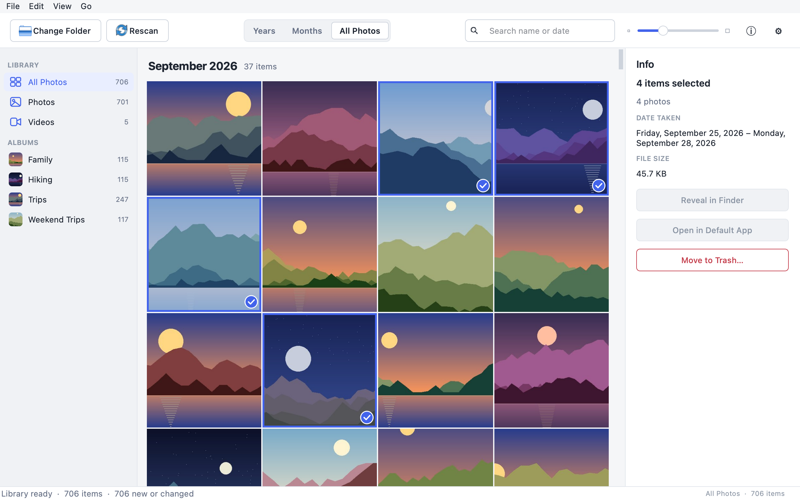
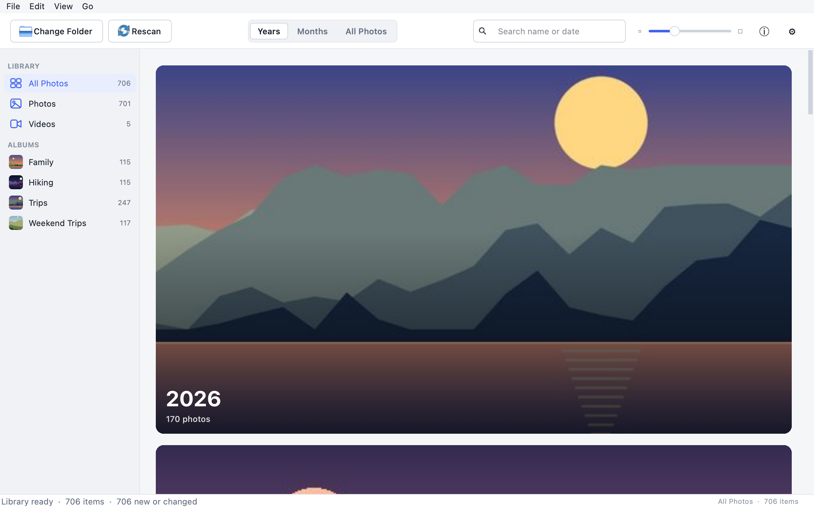
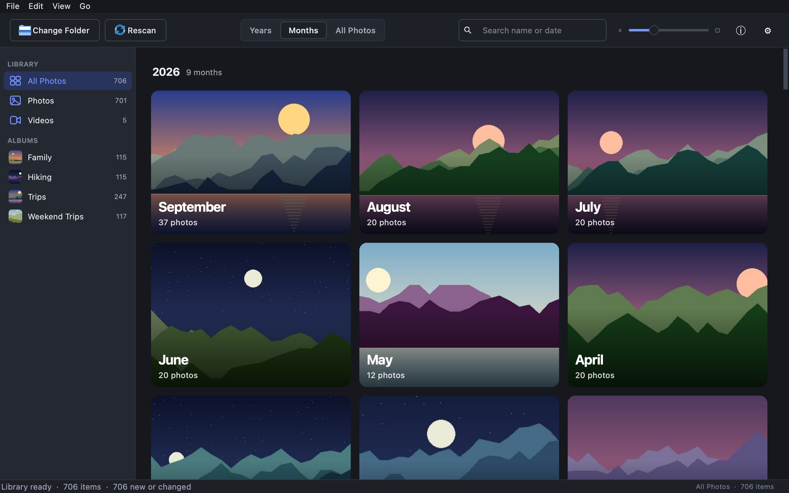
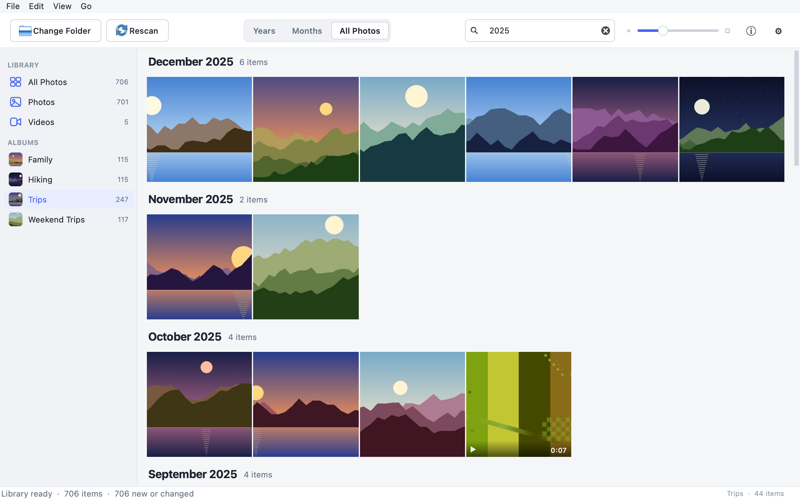
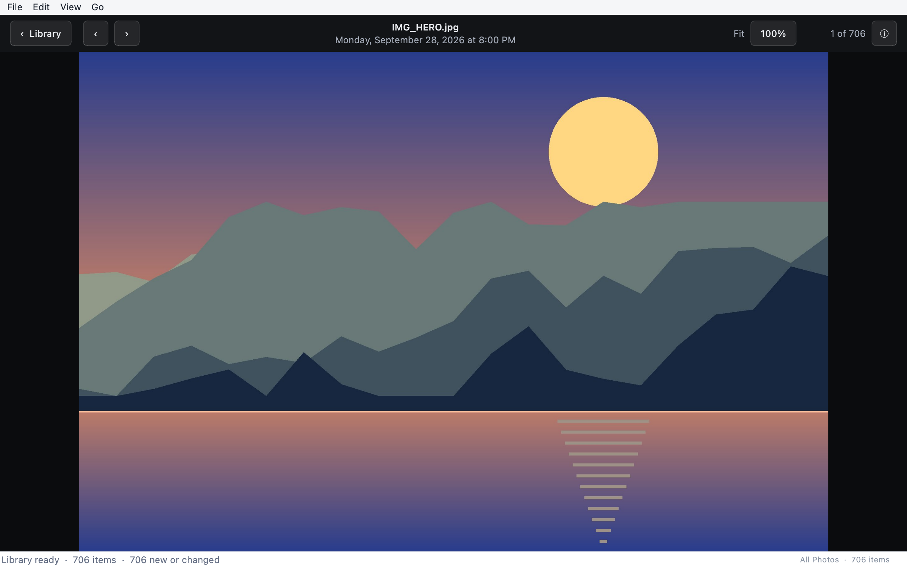

# Photo Library

A fast, private desktop library for the photos and videos in one folder, built with
PySide6. Pick a folder and browse everything in it newest first, grouped by month, in
the style of Apple Photos. Indexing, thumbnails and playback all happen on your
computer. Nothing is uploaded.

The look and the media core (capture-date detection, HEIC support, thumbnail cache,
incremental indexer) come from the On This Day app.

## Features

- **Library folder** chosen once and remembered. It's indexed in the background with a
  progress bar. Every launch, and **Rescan**, picks up added, changed and deleted files.
- **Virtualized grid** that stays smooth with 50,000+ items. It has month section
  headers with a sticky header at the top, and a thumbnail size slider.
- **Years / Months / All Photos** views. Click a year to see its months, and a month to
  jump to it in All Photos.
- **Sidebar**: All Photos, Photos and Videos with counts, plus each top-level subfolder
  as an **album** with its newest photo as a thumbnail. An album includes everything in
  its nested folders. Toggle the sidebar with ⌥⌘S.
- **Search** (⌘F) by filename words and by date: `2023`, `May`, `May 2023`, `2023-05`,
  `2023-05-14` or `14 May 2023`. Words and dates combine (`beach 2023`). Search applies
  to the current sidebar selection. Esc clears it, and Return jumps to the results.
- **Info panel** (⌘I or the ⓘ button) shows the filename, date taken, dimensions, file
  size, camera, duration for videos, album and path. It has **Reveal in Finder** and
  **Open in Default App** buttons. With several items selected it shows the count, the
  date range and the total size. It works in the viewer too.
- **Selection** works like Photos: click, ⌘-click to add, ⇧-click for a range, ⌘A, and Esc
  to deselect. Right-click for Open, Get Info, Reveal, Open in Default App and Move to Trash.
- **Move to Trash** (⌘⌫) works on the selection, or on the item open in the viewer. It
  always asks first, names what will be moved, and uses the system Trash (`QFile.moveToTrash`),
  so files can be restored. Trashed items leave the grid without a reload, the scroll
  position stays put and the next item is selected. Files that couldn't be moved are listed.
- **Empty states** for no folder, an empty library, an empty album, and no search results.
- **Viewer**: double-click, Return or ⌘↓ opens an item full-window. ← and → step through
  the library. Esc (or ⌘↑) returns to the grid exactly where you left it.
  - **Photos** are shown with their EXIF rotation applied. Zoom with ⌘-scroll, pinch,
    ⌘= / ⌘−, or a double-click (Fit ↔ 100%), and drag to pan. The grid thumbnail
    appears at once, then a screen-sized decode replaces it; zooming in past that loads
    the full-resolution image. The next and previous photos are decoded in advance.
  - **Videos** play in the app (QtMultimedia) with play/pause, a scrubber, time, volume
    and mute.

## Screenshots

These screenshots come from a synthetic demo library of computer-drawn landscapes with
made-up dates. They contain no personal photos, file paths or metadata. To regenerate
them, run `python tools/make_screenshots.py`.

### Library with the info panel

All Photos grouped by month, with albums in the sidebar and a multi-item selection
summarised in the info panel.



### Years

One tile per year. Click a year to see its months.



### Months, in dark mode

Month tiles grouped by year, shown with the dark theme.



### Search within an album

Searching "2025" inside the Trips album.



### Viewer

Full-window photo viewer with previous and next, zoom and the info toggle.



## Settings

Open **Settings** with ⌘, or the ⚙ button at the right end of the toolbar (also in the app menu on macOS, or File on other systems) to choose:

- **Theme**: follow the system appearance, or always light or dark.
- **Time format**: follow the system clock, a 12-hour clock (1:30 PM) or a 24-hour
  clock (13:30). It applies wherever a capture time is shown, such as the viewer header.

Qt Multimedia's informational messages (the "Using Qt multimedia with FFmpeg" banner
and FFmpeg's per-file stream details) are hidden. Warnings and errors still appear. To
see everything while debugging, run:

```bash
QT_LOGGING_RULES="qt.multimedia.*=true" python app.py
```

## Requirements

- Python 3.10 or newer (developed on 3.14)
- macOS is the primary target; Windows and Linux should work
- Dependencies in `requirements.txt`: PySide6, Pillow, pillow-heif (HEIC/HEIF) and
  imageio-ffmpeg (video dates, thumbnails and metadata)

The app still runs without pillow-heif or imageio-ffmpeg; HEIC files or video previews
are then limited.

## Run it

```bash
python3 -m venv .venv
source .venv/bin/activate
python -m pip install -r requirements.txt
python app.py
```

### Launch it like an app (macOS)

```bash
python tools/make_launcher.py
```

This builds `dist/Photo Library.app` and installs a copy in `~/Applications`. You can
double-click it, find it with Spotlight, or drag it to the Dock. It's a few KB and contains
no code of its own: it runs this project's `app.py` with the project's `.venv`, so it
always runs your latest code. Notes:

- While the app is running, macOS shows it as **Python** in the Dock and menu bar,
  because Homebrew's Python framework runs apps inside its own `Python.app`.
- Re-run the script if you move the project folder or recreate `.venv`. If the project
  can't be found, the launcher shows an alert.
- Output and errors go to `~/.photo_library/launcher.log`.

To try it without your own photos, generate a synthetic library first:

```bash
python tools/make_demo_library.py ~/Desktop/demo-library --photos 2000 --videos 10
```

## Keyboard shortcuts

On macOS, ⌘ is Command. On Windows and Linux, use Ctrl.

| Action | Shortcut |
| --- | --- |
| **Library** | |
| Choose library folder | ⌘O |
| Rescan library | ⌘R |
| Search by name or date | ⌘F (Esc clears it, Return jumps to the results) |
| Years / Months / All Photos | ⌘1 / ⌘2 / ⌘3 |
| Bigger / smaller thumbnails | ⌘= / ⌘− (or ⌘-scroll, or pinch) |
| Show or hide the sidebar | ⌥⌘S |
| Show or hide info | ⌘I |
| **Selecting** | |
| Move between items | Arrow keys, Page Up/Down, Home/End |
| Add to the selection / select a range | ⌘-click / ⇧-click (or ⇧-arrows) |
| Select all / deselect all | ⌘A / ⌘⇧A (Esc also deselects) |
| **Items** | |
| Open in the viewer | Double-click, Return, Space or ⌘↓ |
| Move to Trash (asks first) | ⌘⌫ or Delete |
| Reveal in Finder | ⌘⇧R |
| Open in default app | ⌘⇧O |
| More actions | Right-click an item |
| **Viewer** | |
| Back to the grid | Esc or ⌘↑ (Space also closes a photo) |
| Previous / next item | ← / → (Home / End for first / last) |
| Zoom photo / actual size | ⌘= / ⌘−, ⌘0 (or double-click, pinch, ⌘-scroll) |
| Play / pause, skip 5 s, mute | Space, ⇧← / ⇧→, M |
| **App** | |
| Settings (appearance, 12/24-hour time) | ⌘, or the ⚙ toolbar button |
| Close window | ⌘W |

## How it stays fast

- **Indexing** (`core/indexer.py`) walks the folder with `os.scandir`. It reads
  metadata on a thread pool, and every SQLite write happens on the indexer's single
  thread. Unchanged files (same size and modification time) are skipped.
- **The grid** (`ui/grid_view.py`) is a custom `QAbstractItemView`. Its geometry comes
  from `core/grid_layout.py`, which works on month sections, not individual items. Lookups
  are binary searches, so painting and hit-testing only touch the cells on screen.
- **Thumbnails** (`ui/thumbnails.py`) are created on disk once (512 px, aspect kept)
  and decoded on worker threads at about the cell's size. They're kept in an in-memory
  LRU of about 320 MB. Queued work for cells that scrolled away is dropped, so what's
  on screen loads first.
- **The UI thread never reads files or the database.** Queries, grouping, settings
  writes and thumbnail decoding run in the background (`ui/tasks.py`).

## Project structure

```text
app.py                     Entry point
photolibrary/
├── core/                  No Qt imports; unit-tested
│   ├── constants.py       Paths, supported formats, thumbnail size
│   ├── database.py        SQLite index (WAL) and MediaRepository queries
│   ├── indexer.py         Incremental background indexer
│   ├── media.py           Dates, metadata, thumbnails, open/reveal helpers
│   ├── grouping.py        Month sections and Years/Months summaries
│   ├── grid_layout.py     Sectioned grid geometry
│   ├── search.py          Search box parsing (filename and dates)
│   ├── trash.py           Move to Trash plus index and thumbnail cleanup
│   ├── cache.py           Cost-bounded LRU cache
│   ├── workqueue.py       Re-prioritisable background job queue
│   ├── formatting.py      Labels for sizes, durations, dates
│   ├── zoom.py            Viewer zoom and pan arithmetic
│   └── settings.py        Remembered settings (JSON)
└── ui/
    ├── main_window.py     Toolbar, sidebar, search, menus, indexing and query plumbing
    ├── time_format.py     12/24-hour clock preference
    ├── grid_view.py       Virtualized grid view and thumbnail delegate
    ├── grid_model.py      Qt model over a library snapshot
    ├── thumbnails.py      Background thumbnail loader and pixmap cache
    ├── tasks.py           run_async helper for background work
    ├── viewer_images.py   Background full-size photo decoding for the viewer
    ├── pages/             Grid page and the full-window viewer
    ├── theme/             Colours, typography, metrics, stylesheet
    └── widgets/           Sidebar, info panel, image canvas, video player, empty state, search box
tests/                     unittest suite for the core
tools/make_demo_library.py Synthetic library generator
tools/make_launcher.py     Builds the macOS launcher app
tools/make_screenshots.py  Regenerates the README screenshots
assets/screenshots/        README screenshots (synthetic demo library)
```

## Development

Run the tests from the project root:

```bash
python -m unittest -v
```

App data (config, the SQLite index, thumbnails and the log) lives in
`~/.photo_library/`. Set `PHOTO_LIBRARY_HOME` to use a different folder, for example
for a demo library:

```bash
PHOTO_LIBRARY_HOME=/tmp/photo-demo python app.py
```

## Project status

The app is under active development. Use a backed-up media library, review detected
capture dates, and keep the local app-data directory out of source control.

## Development approach

Developed with AI-assisted tools under human direction, review, testing, and refinement.

## License

This project is available under the [MIT License](LICENSE).
